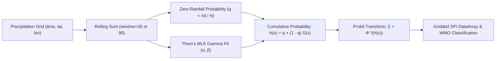

# Indian Climate Digital Twin - GIS Analytics Dashboard

Miraj is evolving toward a three-layer climate digital twin: a gridded-data
ingestion pipeline, climate analytics and forecasting services, and an
interactive GIS decision-support dashboard. The current repository is an MVP:
it decodes IMD rainfall grids, applies administrative-boundary masks, exposes
dataset health through FastAPI, and presents sample climate observations with
rule-based risk screening.


> [!IMPORTANT]
> The bundled NetCDF files contain synthetic demonstration data. Dashboard risk
> indicators are screening aids, not official weather warnings or forecasts.

## Data Sources and Licenses
- **India States Boundary**: The state boundary GeoJSON data (`data/india_states.geojson`) is sourced from the open-source repository [adarshbiradar/maps-geojson](https://github.com/adarshbiradar/maps-geojson).

---

## Setup Instructions

### 1. Clean Environment Setup
Create and activate a virtual environment:

```bash
# Create virtual environment
python -m venv .venv

# Activate virtual environment
# On Windows (PowerShell):
.\.venv\Scripts\Activate.ps1
# On Linux / macOS:
source .venv/bin/activate
```

### 2. Install Dependencies
Install all required runtime and testing dependencies using `requirements.txt`:

```bash
pip install --upgrade pip
pip install -r requirements.txt
```

If installing dependencies individually or adding test/HTTP clients:
```bash
pip install pytest httpx
```

> [!NOTE]
> **NetCDF Engine Requirements (`netcdf4` / `scipy`):**
> `xarray` relies on backend engines to decode and parse NetCDF datasets:
> - **`netCDF4`**: Required for NetCDF-4 and HDF5-based files (`engine="netcdf4"`).
> - **`scipy`**: Fallback/default engine for classic NetCDF-3 32-bit/64-bit offset format files (`engine="scipy"`).
>
> Both `netcdf4` and `scipy` are included in `requirements.txt`. Ensure at least one compatible engine is installed to prevent backend parsing errors (`ValueError` or `OSError`) when calling `xr.open_dataset()`.

---

## Running the Application

### 1. Generate / Decode Sample Data
Ensure the sample NetCDF dataset is available:
```bash
python scripts/generate_mock_imd.py
```
*(or run `scripts/decoder.py` if decoding raw IMD binary/gridded data).*

### 2. Run the FastAPI Backend
Start the status and analytics API service:
```bash
uvicorn app.api:app --reload --host 0.0.0.0 --port 8000
```
Status endpoint: `GET http://localhost:8000/api/status`

### 3. Run the Streamlit Dashboard
Launch the interactive GIS dashboard:
```bash
streamlit run app/streamlit_app.py
```

The dashboard includes:
- State/UT, date, and climate-variable filters
- A boundary-masked state climate heatmap with hover values
- State mean, peak, coverage, and previous-day change indicators
- A national state/UT leaderboard and grid-level threshold filter
- CSV downloads for the national summary, selected grid cells, and state time series
- Temporal trend and value-distribution charts
- Rainfall and high-temperature risk screening with clear operational disclaimers
- Drought Conditions section with 30-day and 90-day Standardized Precipitation Index (SPI) monitoring

---

## Climate Indices & Drought Analytics

### Standardized Precipitation Index (SPI) Engine (`src/climate_indices.py`)
The repository includes a mathematically rigorous, fully vectorized calculation engine for the **Standardized Precipitation Index (SPI)**, formulated by McKee, Doesken, and Kleist (1993) and recommended by the World Meteorological Organization (WMO 2012) as the international standard drought index.

The engine supports multi-scale accumulation windows:
- **30-Day SPI (`SPI-30`)**: Tracks short-term precipitation anomalies, topsoil moisture deficits, and agricultural crop water stress.
- **90-Day SPI (`SPI-90`)**: Tracks medium-term seasonal deficits, groundwater depletion, and hydrological streamflow / reservoir conditions.



### Mathematical Formulation
1. **Rolling Window Accumulation:**
   Precipitation is summed across preceding time points for window length $k \in \{30, 90\}$:
   $$x_t = \sum_{i=0}^{k-1} P_{t-i}$$

2. **Empirical Zero-Precipitation Probability Adjustment:**
   Because precipitation is bounded at zero and the two-parameter Gamma distribution is defined only for $x > 0$, the cumulative probability $H(x)$ accounts for zero-rain observations:
   $$H(x) = q + (1 - q) \cdot G(x)$$
   where $q = \frac{n_0}{N}$ ($n_0$ zero-precipitation occurrences out of $N$ valid accumulated observations), and $G(x) = \frac{\gamma(\hat{\alpha}, x / \hat{\beta})}{\Gamma(\hat{\alpha})}$ is the incomplete gamma cumulative distribution.

3. **Thom's (1958) Maximum Likelihood Estimation:**
   The shape ($\hat{\alpha}$) and scale ($\hat{\beta}$) parameters are estimated directly from positive accumulated observations ($x > 0$):
   $$A = \ln(\bar{x}) - \frac{1}{n} \sum_{i=1}^n \ln(x_i)$$
   $$\hat{\alpha} = \frac{1 + \sqrt{1 + 4A/3}}{4A}, \quad \hat{\beta} = \frac{\bar{x}}{\hat{\alpha}}$$

4. **Probit Standard Normal Transformation:**
   The cumulative probability is mapped to the standard normal distribution $\mathcal{N}(0, 1)$ via the inverse cumulative normal distribution function:
   $$\text{SPI} = Z = \Phi^{-1}(H(x))$$
   To ensure numerical stability against precision boundaries, $H(x)$ is clipped to $[10^{-7}, 1 - 10^{-7}]$.

### WMO Classification Standards (WMO-No. 1090)
| SPI Value | WMO Category | Hydrological / Operational Severity |
| :--- | :--- | :--- |
| $\ge +2.00$ | **Extremely Wet** | Extreme surplus precipitation; acute flood and inundation hazard |
| $+1.50 \text{ to } +1.99$ | **Very Wet** | Substantially above-normal rainfall; elevated surface runoff |
| $+1.00 \text{ to } +1.49$ | **Moderately Wet** | Moderately above normal; favorable moisture conditions |
| $-0.99 \text{ to } +0.99$ | **Near Normal** | Normal hydrometeorological balance |
| $-1.49 \text{ to } -1.00$ | **Moderate Drought** | Soil moisture deficit; early dryland agricultural stress |
| $-1.99 \text{ to } -1.50$ | **Severe Drought** | Crop water stress; irrigation restrictions and reservoir decline |
| $\le -2.00$ | **Extreme Drought** | Widespread water shortages, severe crop failure, and emergency drought |

### Historical Data Requirements & Bundled 7-Day Dataset
> [!IMPORTANT]
> **Why 30+ Observations are Mandatory:**
> Fitting a Gamma distribution requires an adequate sample size ($N \ge 30$) to prevent severe statistical parameter distortion and volatile probability estimation (McKee et al. 1993, WMO 2012).
>
> The bundled demonstration dataset (`data/sample/sample_rainfall.nc`) contains **7 daily observations** (2024-07-01 to 2024-07-07). Under strict scientific integrity rules, the engine **never fabricates or extrapolates artificial SPI values** when data is insufficient.
>
> In the Streamlit dashboard, the **Drought Conditions** section automatically detects sample length and presents a clear informational banner explaining the 30-day historical requirement and directing operators to decode extended historical datasets using `scripts/decoder.py`.

### Python API Usage
```python
import xarray as xr
from src.climate_indices import calculate_spi, classify_spi, assess_drought_condition

# Load gridded precipitation DataArray
ds = xr.open_dataset("data/sample/sample_rainfall.nc")
rainfall = ds["rainfall"]  # Dimensions: (time, lat, lon)

# Calculate 30-day and 90-day gridded SPI
spi_30 = calculate_spi(rainfall, window=30, min_samples=30)
spi_90 = calculate_spi(rainfall, window=90, min_samples=30)

# Classify regional scalar SPI metric
sample_val = -1.65
print(classify_spi(sample_val))  # "Severe Drought"

# Get structured operational assessment
assessment = assess_drought_condition(sample_val, window=30)
print(assessment.severity)       # "severe_drought"
print(assessment.recommendation) # "Implement agricultural irrigation restrictions..."
```

---

### 4. Run Test Suites
Execute the spatial analysis, API, and Streamlit test suites:
```bash
python -m pytest -v tests/
```
